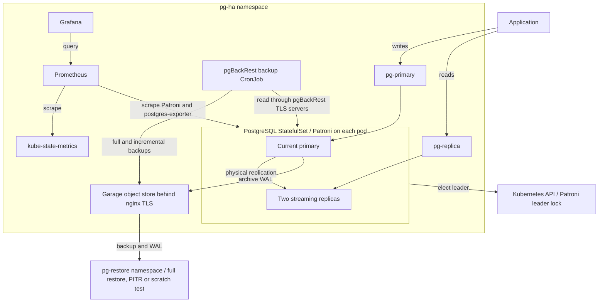
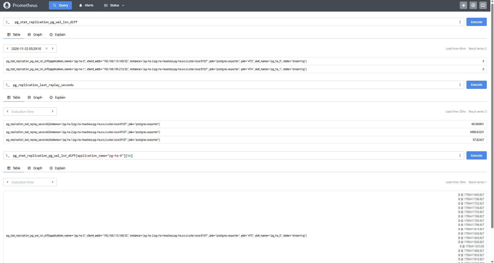
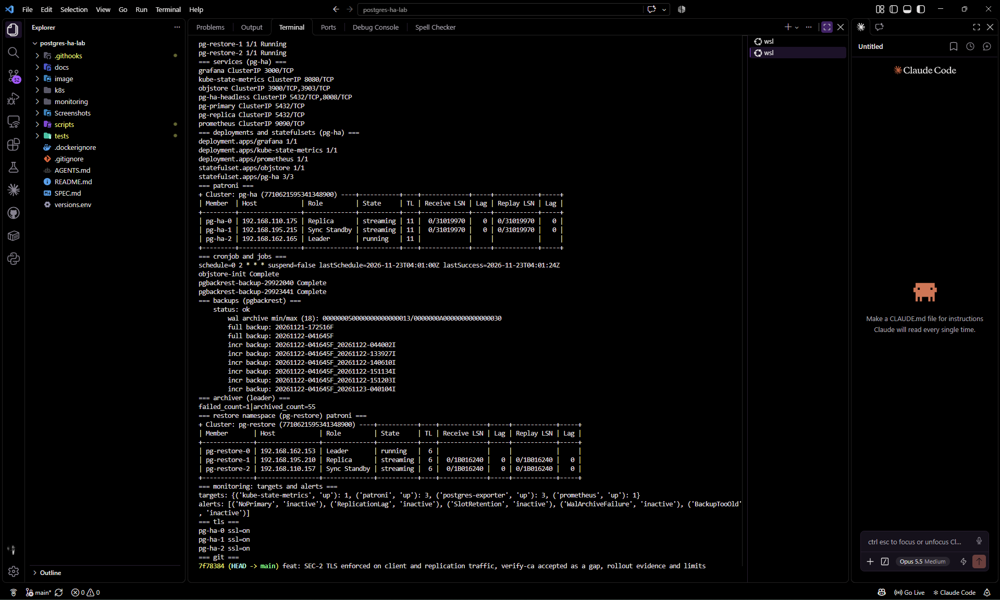

# postgres-ha-lab

PostgreSQL 18 runs on one PC in a four-node kind cluster under WSL. Patroni manages one primary and two streaming replicas. pgBackRest sends backups and archived WAL to Garage, an S3-compatible object store in the same cluster. The workers share a physical host, and Garage has a single local data volume. [Requirements](SPEC.md)

## Architecture

Clients use role-based Services. After a promotion, the new primary serves writes through the same endpoint. Each database pod has its own volume. During healthy operation one synchronous standby confirms commits.

## Run it

Run from the repository root in WSL with Docker, Make, kind, kubectl, jq and OpenSSL available. The validation tools include ShellCheck and kubeconform. [Version pins](versions.env)

    make up           # kind cluster, image build, object store, PostgreSQL, observability
    make test-quick   # static and read-only checks
    make test         # adds live suites; WARNING: they change the running cluster
    make down         # removes pg-restore and pg-ha, keeps the kind cluster

`make up` was re-run on the existing cluster and changed nothing material. A clean-machine run and `make down` were not run by the assistant (see known limitations).
Open the UIs on this PC only: `bash scripts/obs-open.sh` (Prometheus http://localhost:9090, Grafana http://localhost:3000, user admin, password copied to the Windows clipboard).
Restore, switchover and upgrade procedures: [docs/runbook.md](docs/runbook.md).

## What it looks like

Grafana dashboard (leader, replicas, timeline, archiver, WAL, backup age, replication lag):

Prometheus queries for replication lag, taken during the lag tests:

Resource check of the running cluster, part 1 and part 2 (namespaces, pods, services, Patroni, backups, alerts, TLS):

## Where to read more

- [docs/design.md](docs/design.md): RPO, fencing, measured RTO, multi-zone changes, generalisation, determinism, agent-agnostic notes, threat model, AI process
- [docs/known-limitations.md](docs/known-limitations.md): every gap and finding, including failed and partial results
- [docs/decisions/](docs/decisions/0001-sync-vs-async-replication.md): ADRs
- [AGENTS.md](AGENTS.md): rules for any AI agent

## Honest status

The final live check on 25 November 2026 showed one primary, two streaming standbys with zero reported lag, and four Ready kind nodes. [Final cluster health](docs/evidence/ITEM30-final-8swvNeLT/final-health.txt)

| Drill | Observed result |
|---|---|
| Primary pod loss | Writes recovered with a maximum gap of 12.190 s. The same pod retained leadership, leaving promotion on pod loss unverified. [Pod drill](docs/evidence/ITEM30-FO-1-retry-20261125T0605Z.txt) |
| Primary worker or storage loss | A replica promoted automatically in both drills. The longest gaps between acknowledged writes were 32.048 s for worker loss and 15.095 s for storage loss. All checked acknowledgements survived. [Worker drill](docs/evidence/ITEM30-FO-2-dNvaKPVM/result.txt) and [storage drill](docs/evidence/ITEM30-FO-3-jDYQz4qD/result.txt) |
| Fencing and rejoin | At most one pod was writable across 26 sampling rounds. In the divergence drill the former primary rejoined using pg_rewind. [Fencing](docs/evidence/ITEM30-final-8swvNeLT/fo-split-brain.txt) and [rejoin](docs/evidence/ITEM30-final-8swvNeLT/fo-rejoin.txt) |
| Backup and recovery | A controller-triggered backup passed verification. Full restore matched the 1,000-row checksum on all three pods. PITR retained all 500 pre-target rows and zero post-target rows. The socket-only scratch restore passed after its startup fix. [Backup](docs/evidence/ITEM30-final-8swvNeLT/bk-cron-live.txt), [full restore](docs/evidence/ITEM30-final-8swvNeLT/rs-full.txt), [PITR](docs/evidence/ITEM30-final-8swvNeLT/rs-pitr.txt) and [scratch restore](docs/evidence/ITEM30-final-8swvNeLT/rs-restore-test-retry.txt) |

**Follow-up verification on 25 November**

- An isolated three-member cluster completed a rolling PostgreSQL 18.6-to-18.7 upgrade with zero missing acknowledged writes. [Upgrade rehearsal](docs/evidence/gap-verification/minor-upgrade.txt)
- Both streaming replicas now verify the primary certificate against the mounted CA. A lagging replica fetched archived WAL and resumed streaming after the slot cap released its required segment. [TLS check](docs/evidence/gap-verification/tls-after.txt) and [slot recovery](docs/evidence/gap-verification/slot-recovery.txt)
- Prometheus recorded all five configured alerts firing. For BackupTooOld, firing overlapped a measured scheduled-backup age above 36 hours. [Alert history](docs/evidence/gap-verification/alert-history-detailed.txt) and [backup-age evidence](docs/evidence/gap-verification/alert-36h.txt)
- All 84 Kubernetes resources passed strict kubeconform validation. Both formerly stale backup checks passed, including a new full backup while retention held the full count at two. [Manifest validation](docs/evidence/gap-verification/manifests.txt), [backup configuration](docs/evidence/gap-verification/backup-static.txt) and [retention-aware schedule check](docs/evidence/gap-verification/backup-schedule.txt)

**Remaining gaps**

- During complete replica isolation, the configured non-strict synchronous policy allows asynchronous writes. A permanent loss of the primary during that window can lose acknowledged data. [Degraded-mode drill](docs/evidence/ITEM30-final-8swvNeLT/rep-degraded-sync.txt)
- The controller completed backups on temporary schedules. A successful Job at the regular 02:00 UTC schedule is still awaiting evidence. [Recorded Job timestamps](docs/evidence/gap-verification/cron-observations.txt)
- The image scan includes critical and high findings. Trivy lists no fix for one critical and 102 high findings in the tested database image. [Fix availability](docs/evidence/gap-verification/image-fixability.txt)
- Fresh-cluster bring-up succeeded on this PC. The first clean test stopped because it checked restore-pod security before a restore existed. The next clean test attempt stopped during bring-up when the API timed out under load. End-to-end teardown on a fresh cluster remains unverified. [First clean test](docs/evidence/gap-verification/clean-test.txt)
