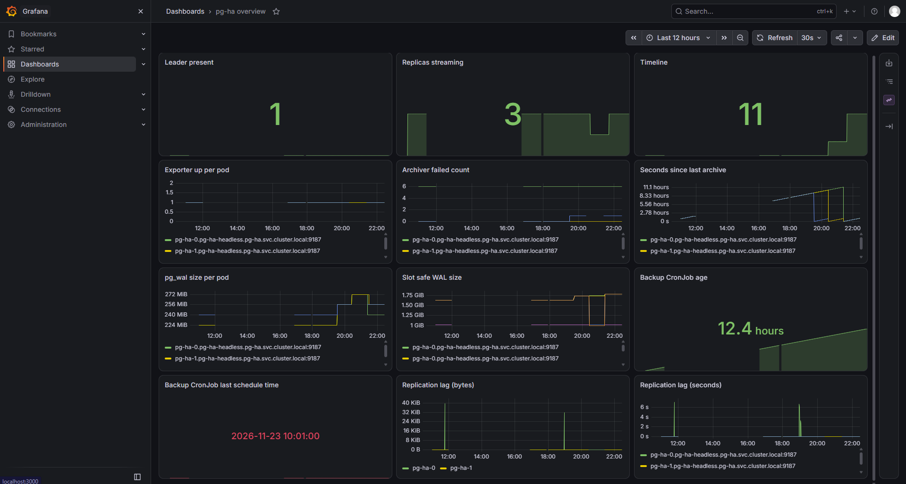
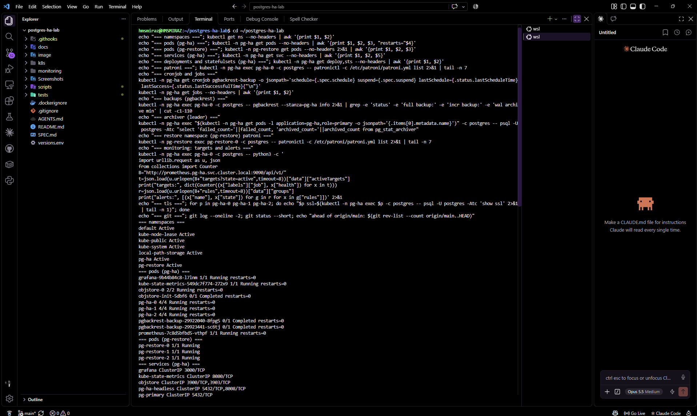

# postgres-ha-lab

Highly available PostgreSQL 18 on Kubernetes without a Postgres operator: Patroni (Kubernetes API as DCS), pgBackRest with WAL archiving and PITR to an in-cluster
object store (Garage behind an nginx TLS front), TLS, NetworkPolicies, Prometheus alerts and a Grafana dashboard. Everything runs on one PC in a kind cluster (WSL).
Requirements are in [SPEC.md](SPEC.md); every requirement has a test in `tests/` and evidence in `docs/evidence/`.

## Run it

Needs Docker, kind, kubectl, jq, openssl, shellcheck; versions are pinned in `versions.env`.

    make up           # kind cluster, image build, object store, PostgreSQL, observability
    make test-quick   # static and read-only checks
    make test         # adds live suites; WARNING: they change the running cluster
    make down         # removes pg-restore and pg-ha, keeps the kind cluster

`make up` was re-run on the existing cluster and changed nothing material. A clean-machine run and `make down` were not run by the assistant (see known limitations).
Open the UIs on this PC only: `bash scripts/obs-open.sh` (Prometheus http://localhost:9090, Grafana http://localhost:3000, user admin, password copied to the Windows clipboard).
Restore, switchover and upgrade procedures: [docs/runbook.md](docs/runbook.md).

## What it looks like

Grafana dashboard (leader, replicas, timeline, archiver, WAL, backup age, replication lag):

Prometheus queries for replication lag, taken during the lag tests:

Resource check of the running cluster, part 1 and part 2 (namespaces, pods, services, Patroni, backups, alerts, TLS):

## Where to read more

- [docs/design.md](docs/design.md): RPO, fencing, measured RTO, multi-zone changes, generalisation, determinism, agent-agnostic notes, threat model, AI process
- [docs/known-limitations.md](docs/known-limitations.md): every gap and finding, including failed and partial results
- [docs/decisions/](docs/decisions/0001-sync-vs-async-replication.md): ADRs
- [AGENTS.md](AGENTS.md): rules for any AI agent

## Honest status

Not met or not shown: verify-ca replication, a clean-machine `make up`, a live minor-version upgrade (18.7 was the newest tag), the real 02:00 UTC backup firing, live firing of two alerts, and fixes for image scan findings.
